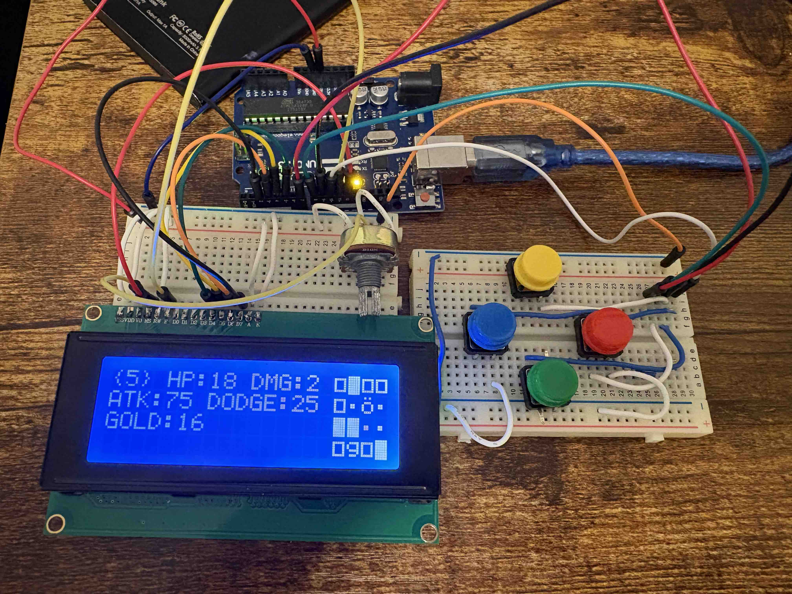

# Maze of the Necromancer - An Arduino LCD Game

This is a handheld roguelike dungeon crawler that runs on an Arduino (Nano in my case) with a 20x4 LCD screen attached.

I originally wrote it in Python and ran it on a Raspberry Pi. I then converted the code to C++ for the Arduino and adjusted the pins as needed.

